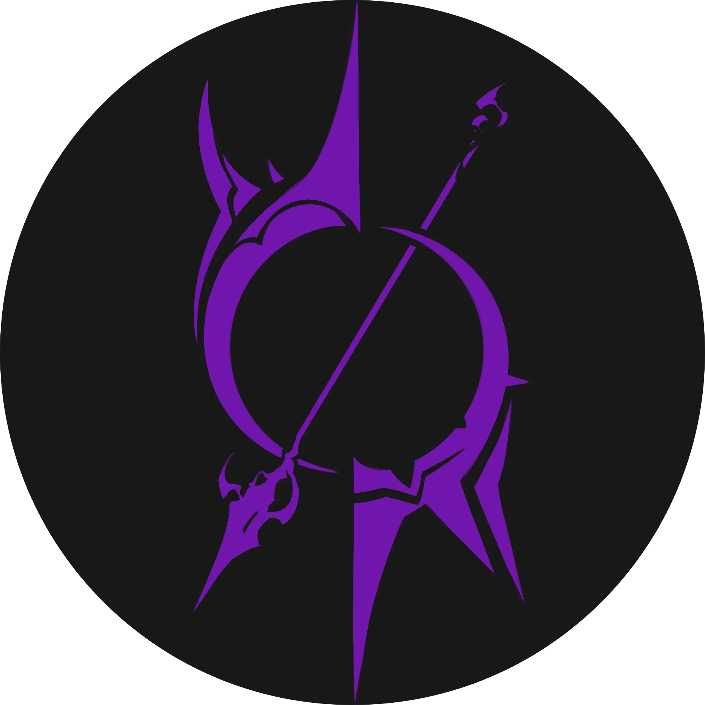
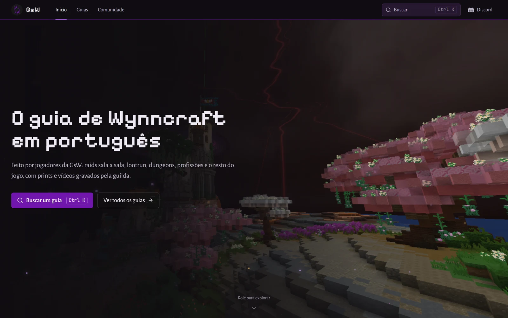

<div align="center">
  

  <h1>GsW · Guardians of Wynn</h1>

  <p><strong>Guias de Wynncraft em português, feitos pela guilda.</strong><br>O portal da GsW: a nossa história e o que aprendemos jogando.</p>

  <a href="https://gsw.chiconeto.dev/"><strong>gsw.chiconeto.dev</strong></a>

  <br><br>

  
  
  
  
  
  
</div>

<br>



## O projeto

A GsW é uma guilda brasileira de Wynncraft, o MMORPG dentro do Minecraft, desde 2017. Este site reúne o que a guilda sabe sobre o jogo em guias passo a passo, em português, e guarda a nossa história: os membros, a galeria e a Guild House.

É um site de fãs. Não é oficial e não tem vínculo com a Wynncraft, a Mojang ou a Microsoft.

## O que há para ver

- **Raids sala a sala:** as cinco raids com cada variação explicada e vídeos em POV da guilda.
- **Guias do jogo:** Leveling, Profissões, Montarias, Lootrun, Dungeons, World Events, Silverbull Shares, Modos especiais e Festivais, com fatos conferidos na wiki e as fontes no fim.
- **Sites úteis:** as ferramentas que a comunidade usa, com filtro por categoria.
- **Guild House:** a nossa sede, com um mapa da ilha em que cada setor é clicável.
- **Caixa de item:** os termos do jogo abrem uma explicação no estilo da interface do Wynncraft.
- **Busca com Ctrl+K:** encontra guias e seções inteiras, por nome, sigla ou sinônimo.

## Stack

| Área | Tecnologias |
|---|---|
| Base | Next.js 16 (App Router, export estático), React 19, TypeScript |
| Estilo | Tailwind CSS 4 com tokens próprios (direção visual "Caixa de Item") |
| Movimento | CSS e IntersectionObserver; Lenis para a rolagem suave, baixado sob demanda |
| Conteúdo | Dados tipados em arquivos `*-content.ts`, sem banco e sem painel |
| Imagens | `sharp` no build: variantes responsivas em WebP, vídeos MP4 no lugar de animações pesadas |
| Infraestrutura | Caddy num contêiner sem root, em VPS própria, atrás de um proxy com HTTPS automático |
| Entrega | GitHub Actions: CI em toda PR e deploy a partir da `main` |

## Decisões técnicas

**Só arquivos estáticos.** O site inteiro é gerado no build. Não há servidor de aplicação no ar: o contêiner é um Caddy que serve arquivos com teto de 64 MB de memória.

**Imagens no tamanho de cada tela, sem otimizador em tempo real.** Um carregador próprio do `next/image` aponta para variantes geradas no build. As páginas pesam o mesmo que com o otimizador do Next, sem o custo de memória dele.

**Compressão feita uma vez.** HTML, JS e CSS saem do build já em zstd, brotli e gzip. O servidor escolhe a versão certa e não comprime nada a cada visita.

**Conteúdo em dados, layout em componentes.** Todo texto de guia mora em `data/`. Um guia novo segue o mesmo modelo (ficha, índice "Nesta página", seções, fontes) e o teste falha se faltar algo no registro.

**Acessível por padrão.** As animações respeitam `prefers-reduced-motion`, todo estado tem ícone e texto (nunca só cor), e a navegação funciona inteira pelo teclado.

**Imagens de terceiros isoladas.** O que vem da wiki ou da Wynncraft fica numa pasta própria, com crédito e link em cada legenda. Para remover tudo de uma vez, basta apagar a pasta.

**Deploy sem acesso amplo.** A chave da CI só consegue disparar o deploy. Se o build falhar, a versão no ar continua, e voltar para a anterior leva segundos.

## Estrutura

```
app/                      # Rotas: cada page.tsx só renderiza o componente da página
components/
├── <area>/               # Um guia por pasta: pages/, sections/ e data/ (o texto)
├── guias/                # Peças do modelo de guia: ficha, seção, galeria, termo, busca
└── shared/               # Top bar, rodapé, imagens, vídeo e animações
lib/                      # Registro dos guias, glossário, variantes das imagens
infra/                    # Dockerfile, Caddy, compose e scripts de deploy da VPS
docs/                     # Arquitetura, design, produto, padrões, CI/CD e infraestrutura
```

## Rodando localmente

```bash
npm install
npm run dev     # servidor de desenvolvimento em http://localhost:3000
npm run check   # tipos, lint, testes e o build estático
npm start       # serve a pasta out/ como em produção
```

A documentação completa está em [`docs/`](./docs), e as regras para quem trabalha no código, em [`AGENTS.md`](./AGENTS.md).

## Autoria e licença

Criado e mantido pela **GsW**.

© 2024-2026 GsW. Todos os direitos reservados. O código está público para consulta, mas não pode ser copiado, modificado ou redistribuído sem autorização. Veja a [licença](./LICENSE). Wynncraft e seus assets © Wynncraft Studios; Minecraft © Mojang AB.
